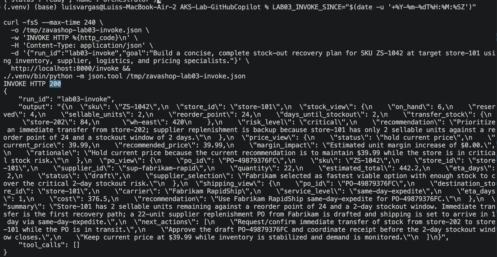
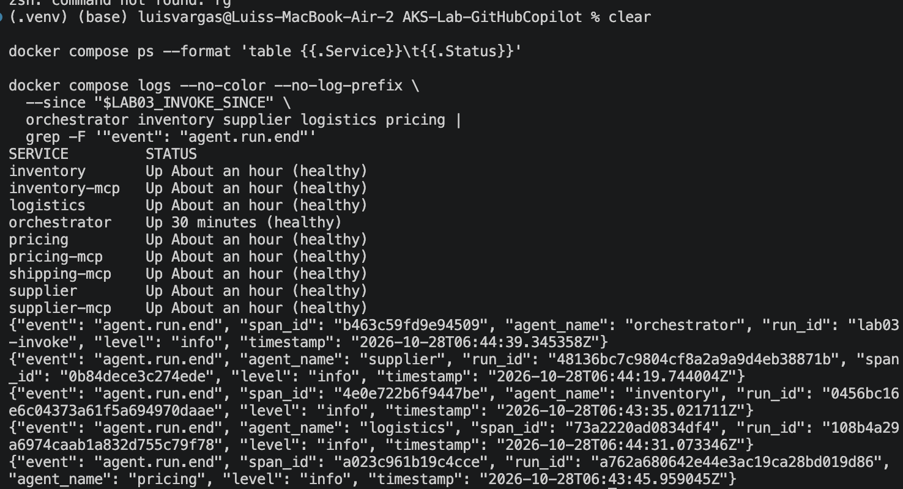
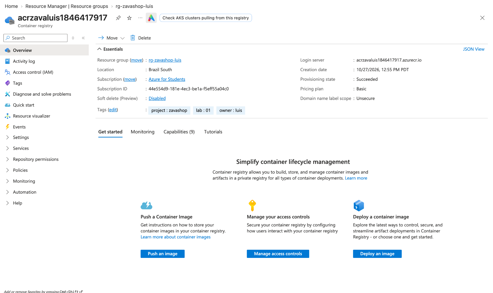

## Lab 03 — Evidence
The local Docker Compose stack runs nine healthy services. Both
`/plan` and `/invoke` returned successful responses. The free-form
invocation passed the supplier's actual draft purchase order ID
and quantity to logistics to obtain a shipping quote.

### Terminal — Orchestrator invocation

### Terminal — Services and specialist traces
The nine services are healthy. The logs show completed runs for
inventory, pricing, supplier, and logistics, including span IDs.

### Azure Portal — Key Vault
Azure Key Vault contains five enabled secrets: the GitHub token
and the four MCP server URLs. Secret values are not displayed.
