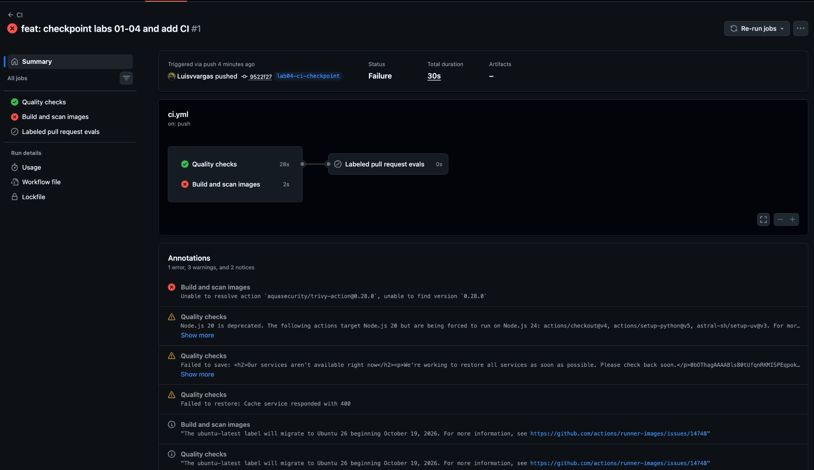
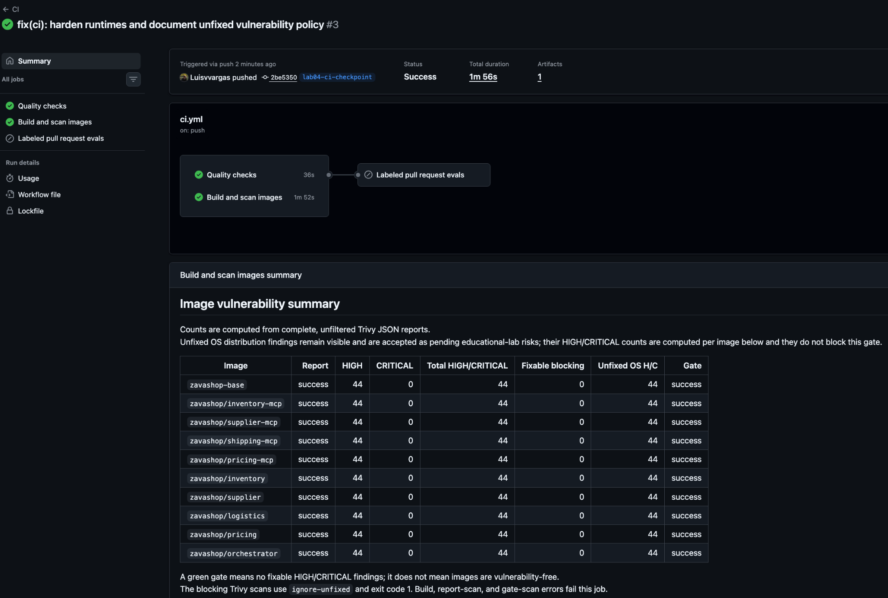
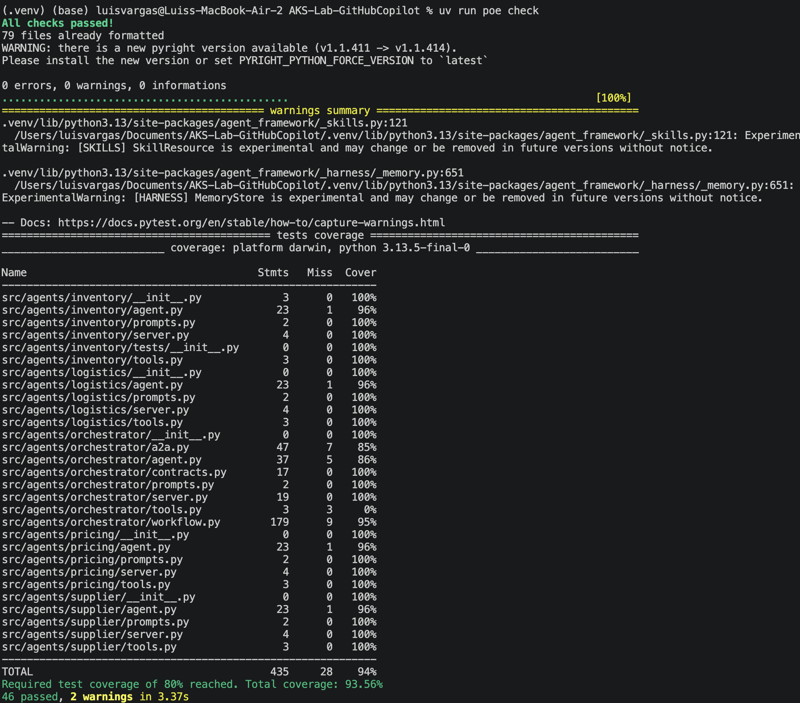
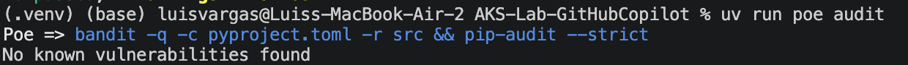
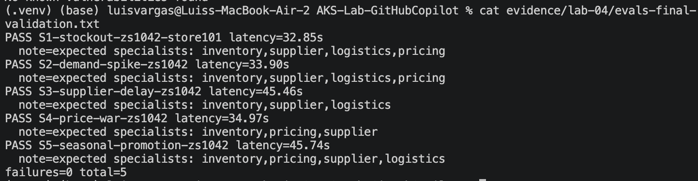

*THIS IS ALSO IN LAB4 README.md*
## Execution Results and Evidence
### Quality checks and evaluations
- `uv run poe check`: passed — 46 tests, 93.56% agent coverage,
  Ruff and Pyright clean.
- `uv run poe audit`: passed — no known vulnerabilities reported.
- The full live eval suite passed all five scenarios with zero failures.
  All scenarios completed within their 180-second budgets.

| Scenario | Result | Latency |
|---|---|---|
| S1 — Stock-out | PASS | 32.85s |
| S2 — Demand spike | PASS | 33.90s |
| S3 — Supplier delay | PASS | 45.46s |
| S4 — Price war | PASS | 34.97s |
| S5 — Seasonal promotion | PASS | 45.74s |

Earlier runs showed intermittent missing mentions in S3 and S5.
The final run passed without a production-code fix; the root cause
remains unconfirmed. Optional sanitized JSON diagnostics and offline
tests were added to support future investigation.

The `/plan` endpoint does not expose tool-call traces. Therefore,
`recorded_calls` is `null`, and expected-specialist notes are not
evidence of actual calls.

### Image security
Image-security CI passed on `lab04-ci-checkpoint`.
Complete reports retain unfixed vulnerabilities; the blocking gate
rejects HIGH/CRITICAL findings with an available fix.

The documented scan reported 44 unfixed Debian HIGH findings per image.
These remain open risks under the policy documented in
`specs/lab-04-tests.md`. A passing gate does not mean vulnerability-free
images.

#### CI before and after remediation
- **Before (`ci-before-fix.png`):** the earlier CI execution failed during
  image-security validation.
- **After (`ci-after-fix.png`):** CI passed after correcting the Trivy action
  reference, removing unnecessary runtime installer components containing
  vulnerable Python packages, and applying the documented vulnerability policy.

The final gate blocks fixable HIGH/CRITICAL vulnerabilities. Unfixed
findings remain visible in the complete reports; they were not resolved
by changing the gate.

[Complete image-security reports](../../evidence/lab-04/Security%20Reports.zip)

### Step 8 limitation
[Issue #1](https://github.com/Luisvvargas/AKS-Lab-GitHubCopilot/issues/1)
records the observed S5 failure. The investigation used that failure
instead of introducing the tutorial's S3 regression.

The remote GitHub Copilot Coding Agent was unavailable under the
account's Copilot Free license. Investigation and diagnostic changes
were performed using local Copilot in VS Code.

**The remote Coding Agent PR requirement remains incomplete.**
Local Copilot work is not presented as fulfilling that requirement.

### Remaining submission work
- Integrate the final changes through a regular pull request.
- Verify CI on `main`.

### Evidence

- [Final eval output](../../evidence/lab-04/evals-final-validation.txt)
- [Sanitized eval diagnostics](../../evidence/lab-04/evals-final-validation.json)